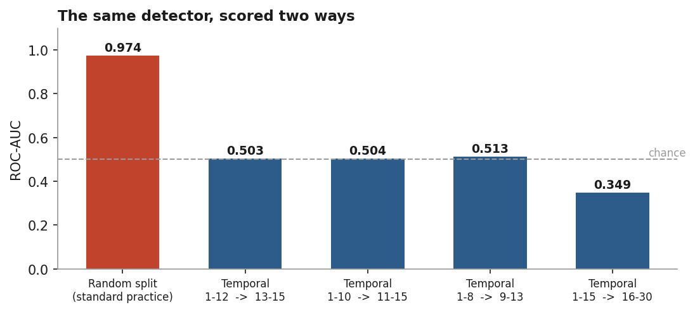
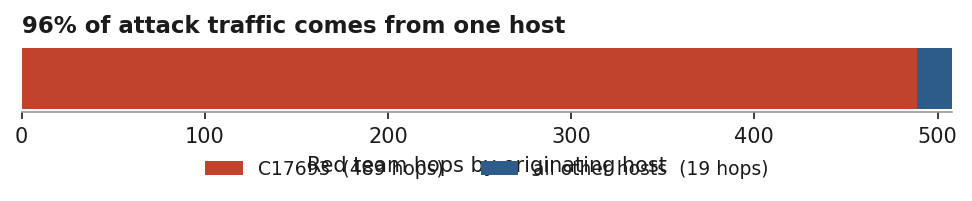
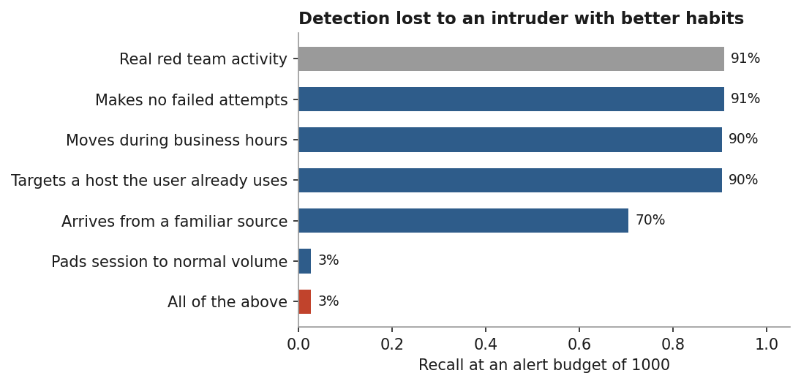

# Can you tell whether a cyber anomaly detector works?

An assurance audit of lateral-movement detection on the Los Alamos National
Laboratory authentication dataset (Kent, 2015).

The object under test here is not a detector. It is the **evaluation**. The
question is how much of a detector's reported performance on this benchmark
survives contact with an honest protocol and an adversary who adapts.

Short answer: very little of it.

| | |
|---|---|
| Random split, standard practice | **ROC-AUC 0.974** |
| Forward-in-time split, same model and features | **ROC-AUC 0.349 to 0.513** |
| Honest split, after being told the attacker's host address | **ROC-AUC 0.983** |
| Best detector, against an intruder who pads session volume | **recall 91% to 2.6%** |

---

## The data

[Comprehensive, Multi-Source Cyber-Security Events](https://csr.lanl.gov/data/cyber1/),
58 consecutive days from LANL's internal network, released CC0. Ground truth is
`redteam.txt`: 749 authentication events belonging to a known red team exercise.

The pipeline streams the 7.6 GB compressed `auth.txt.gz` directly from
csr.lanl.gov, decompresses in flight and discards everything it does not need,
so the ~70 GB decompressed file is never written to disk. It runs on a laptop.

| stage | rows |
|---|---|
| authentication events read | 1,051,430,459 |
| lateral-movement candidates kept | 122,407,032 |
| hops after aggregation | 4,246,513 |
| red team hops | 508 |

A **hop** is one `(user, source host, destination host, day)` tuple. That is the
unit an analyst actually triages, and it keeps the study inside laptop memory.

**Known limitation.** The lateral filter keeps events where the destination host
differs from the source, the account is a user rather than a machine account,
and the orientation is `LogOn`. That captures 702 of the 715 distinct red team
tuples. The 13 it misses are self-authentications or non-LogOn orientations and
are dropped by design, not by accident.

### Splits

Red team activity runs from day 2 to day 30 and is heavily concentrated: day 9
carries 273 events and day 13 carries 209.

| split | days | hops | red team |
|---|---|---|---|
| train | 1 to 15 | 1,087,945 | 449 |
| test | 16 to 30 | 1,051,442 | 59 |
| clean | 31 to 58 | 2,107,126 | 0 |

Attacks are 0.0056% of the test window. The clean period contains no known
intrusion at all, which makes it a direct measure of the false alarm rate.

### Features

Seventeen features per hop, in two groups. History features
(`new_user_dst`, `new_host_edge`, `new_user_src`, degree counts) are computed
from **strictly earlier days only**. Same-day features (`n_events`, `fail_rate`,
`off_hours_rate`, `span`, auth and logon type counts) come from the hop itself.

Computing "has this user ever reached this host" across all 58 days at once
would be trivially leaky. Avoiding that leak is a precondition for the rest of
the study, not an optimisation.

Detector: gradient-boosted trees, class-reweighted. At a 0.04% positive rate an
unweighted model collapses to a near-constant prediction and its ranking becomes
indistinguishable from random. Evaluation always runs on the untouched
population, so precision at a given alert budget stays honest.

---

## Finding 1: the protocol produces the result



Identical features, identical model, identical data. The only thing that changes
is how the split is drawn.

| protocol | ROC-AUC | average precision |
|---|---|---|
| random split | 0.974 | 0.449 |
| temporal, train 1-12, test 13-15 | 0.503 | 0.000 |
| temporal, train 1-10, test 11-15 | 0.504 | 0.001 |
| temporal, train 1-8, test 9-13 | 0.513 | 0.001 |
| temporal, train 1-15, test 16-30 | 0.349 | 0.000 |

Four forward-in-time boundaries, all at or below chance. This is not one
unlucky cut.

**Why the random split flatters so badly.** Of the attack hops in the random
test half, **89.6% share an account with an attack hop in the training half**,
and **44.4% reuse the exact same source-destination host pair**. The model is
not generalising to unseen intrusions. It is recognising a campaign it has
already seen, from both ends.

**Why the last row is below chance.** The novelty signal decays as the intrusion
matures. Red team hops reaching a never-before-seen destination fall from 0.639
in days 1-15 to 0.220 in days 16-30; unseen source-destination edges fall from
0.717 to 0.136. The attacker's own paths become part of the history that defines
normal. A detector trained on the opening of an intrusion learns features that
the same intrusion erases.

### What an analyst would actually see

ROC-AUC is close to meaningless at a 0.0056% base rate. The operational question
is what arrives in the queue.

| alerts sent | true positives | precision |
|---|---|---|
| 10 | 0 | 0% |
| 100 | 0 | 0% |
| 1000 | 1 | 0.1% |

Over the 28 days containing no known intrusion, the same threshold fires **300
times, 10.7 alerts per day, every one of them false**.

---

## Finding 2: the benchmark cannot test what matters most



Giving the model the source host's identity transforms it under the honest
temporal split:

| | ROC-AUC | true positives in 100 alerts |
|---|---|---|
| behavioural features only | 0.349 | 0 of 59 |
| plus source-host identity | 0.983 | 55 of 59 |

That looks like the headline result of the project. It is not, because of how
the ground truth is distributed: **489 of 508 red team hops (96.3%) originate
from a single host, C17693**, across only four attacker hosts in total.

So the obvious test is to hold that host out, train on it, and see whether the
detector still finds attacks arriving from somewhere else. The test cannot be
run. Every red team hop in the test window from a non-dominant host belongs to
**one user on one host** (U737@DOM1 from C19932, seven hops to seven
destinations). The identity model scores 7 of 7 on them and the behavioural
model scores 0 of 7, and **neither number is evidence of anything**: the
effective sample size is a single intrusion path.

The honest conclusion is about the benchmark rather than the detector. A dataset
in which 96% of attack traffic leaves from one machine cannot distinguish a
detector that learned attacker behaviour from one that learned an attacker's
address. Any paper reporting strong numbers on this data without addressing that
has not established the thing it appears to establish.

---

## Finding 3: the best detector folds against small changes in habit



Tested against the random-split model, at ROC-AUC 0.974, because that is the
only detector the standard protocol would ever have shipped. Running evasion
against the temporal model would prove nothing, since it is already at chance
before the adversary does anything.

Each variant is a counterfactual over the real red team hops, representing one
habit a more careful intruder would adopt. Recall is measured at an alert budget
of 1000.

| intruder behaviour | recall | lost |
|---|---|---|
| unmodified red team activity | 90.9% | |
| makes no failed attempts | 90.9% | none |
| targets a host the user already uses | 90.4% | 0.5 pt |
| moves during business hours | 90.4% | 0.5 pt |
| arrives from a familiar source | 70.4% | 20.5 pt |
| **pads session to normal volume** | **2.6%** | **88.3 pt** |
| all of the above | 2.6% | 88.3 pt |

Almost all of the detector's power rests on a single habit. Red team hops
average 1.5 authentication events over a 1,436 second span; ordinary hops
average 29.3 events over 34,141 seconds. The detector is largely a
short-and-quiet detector. An intruder willing to pad a session to ordinary
volume walks past it, and nothing else they do matters much by comparison.

**Caveat, stated plainly.** These are counterfactuals in feature space, not
re-simulated intrusions. Setting `new_user_dst` to zero is exactly what would
happen had the attacker chosen a host the account already used, so that one is
faithful. Padding session volume is operationally plausible but not free: it
costs the intruder noise and time, which a real adversary would weigh. The
honest reading is that this bounds how brittle the detector is, not that evasion
is costless.

---

## Reproducing

```bash
pip install -r requirements.txt
export AUTH_URL="<your data-fence link for auth.txt.gz>"
./run.sh
```

The download link is per-registration. Fill in the short form at
[csr.lanl.gov/data/cyber1](https://csr.lanl.gov/data/cyber1/) to get one.

| stage | runtime |
|---|---|
| stream and reduce 7.6 GB | ~47 min |
| aggregate to hops | ~45 s |
| audit | ~6 min |

```
src/reduce_auth.py   stream auth.txt.gz, keep lateral candidates, join ground truth
src/aggregate.py     collapse events to (user, src, dst, day) hops
src/features.py      causal features, history from strictly earlier days
src/audit.py         the three experiments
src/plots.py         figures
```

Peak memory is about 2 GB. Peak disk, excluding the optional intermediate, is
under 100 MB; the raw dataset is never stored.

## What I would do next

- Replay the attacks as real event sequences rather than feature-space
  counterfactuals, so the cost of evasion to the attacker can be priced.
- Repeat the audit on the [Unified Host and Network Data Set](https://csr.lanl.gov/data/2017/),
  which spans 90 days, to check whether the novelty-decay effect reproduces.
- Test whether a detector trained on per-user baselines rather than global
  history degrades more gracefully as an intrusion matures.

## Citation

> A. D. Kent, "Comprehensive, Multi-Source Cyber-Security Events,"
> Los Alamos National Laboratory, http://dx.doi.org/10.17021/1179829, 2015.

Dataset released under CC0. This analysis is independent and is not affiliated
with or endorsed by Los Alamos National Laboratory.
